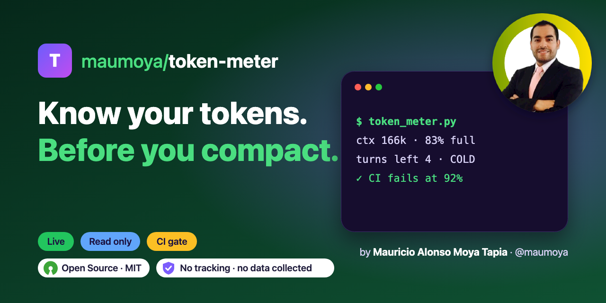
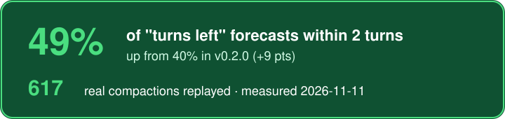
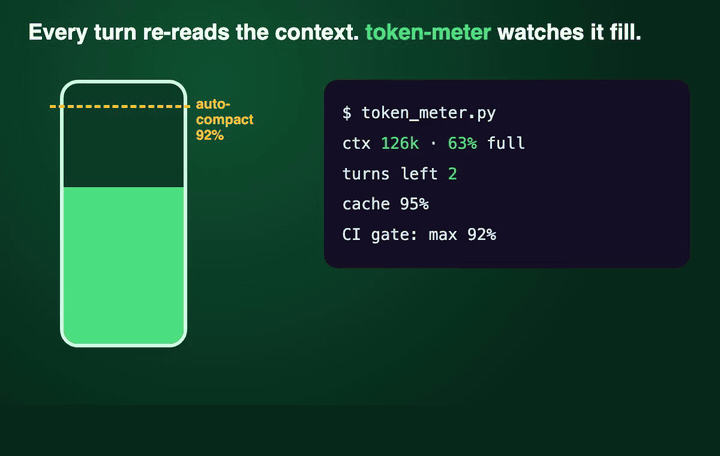

<!-- Badge row: regenerate with skill-forger-e2e's badges.sh. Numbers live in launch/facts.json (sync.py). -->
<p align="center">
  
</p>

<p align="center">
  
  <a href="#results-measured-2026-11-11"></a>
  
  <a href="https://opensource.org/license/mit"></a>
  
  <a href="https://scorecard.dev/viewer/?uri=github.com/maumoya/token-meter"></a>
</p>

<p align="center">
  <a href="#results-measured-2026-11-11"></a>
</p>

<p align="center">
  
</p>

# Token Meter

**Know your tokens before you compact.** A live token meter for Claude Code, plus a GitHub Action that fails a
CI job when an agent run filled too much of its context window.

Every Claude Code call re-reads the whole context, so context size is the cost driver. Token Meter shows it per
running session: context size, how full the auto-compact window is, turns left before compaction, cache share, a
cold-cache warning, main versus subagent tokens, and the MCP servers and skills you never call. So you know when
to compact, when to start fresh and what to switch off. With `--advise` it goes one step further and proposes
the cuts and improvements itself: compact now, start fresh, trim the baseline, split plan and build models, a
local model for lookups, a skill for a repeated step, and MCP servers and skills to turn off.

Read only, offline, Python standard library. No hooks, no telemetry, no settings edits.

```
3 live session(s) in the last 15 min · auto-compact window 200k (settings env)
  3e359cce  ctx  166k  83% · turns left   4 · cache 93% · base 113k · spent 37.4M (sub 347k) · no price · claude-opus-5-5
      tools Bash 221, Write 22, Edit 12, Read 9 · MCP github 34 · skills code-review 2
  16439f1d  ctx  161k  81% · turns left  20 · cache 97% COLD · base 91k · spent 55.8M (sub 152k) · no price · claude-opus-5-5
      tools Bash 327, Write 17, Read 12
  never called in 7 days, MCP servers: notion
  never called in 7 days, skills: old-skill, unused-skill
```

## Install

As a Claude Code plugin:

```
/plugin marketplace add maumoya/token-meter
/plugin install token-meter@token-meter
```

Or for any agent (Claude Code, Codex, Cursor, Gemini CLI):

```bash
npx skills add maumoya/token-meter
```

Then ask "how full is my context?" or run `/token-meter`. Or run the script directly (Python 3.10+):

```bash
python3 skills/token-meter/scripts/token_meter.py --unused
```

## What it shows

| Field | Meaning |
|---|---|
| `ctx` / `%` | context of the latest call, and how full the auto-compact window is |
| `turns left` | turns until compaction at the average growth of the last 8 turns |
| `base` | context of the first call: your fixed cost (instructions, MCP tool lists, skills) |
| `cache` | share of input read from the prompt cache |
| `COLD` | idle past the cache life (5 min, or 1 h for the long cache): the next call re-writes it all |
| `spent` / `sub` | all tokens of the session, and the part used by subagents (`N runs`) |
| `compacted Nx` | how many times the session was compacted |
| tools, MCP, skills | calls per tool, MCP server and skill |
| never called | connected MCP servers and personal skills no session used in 7 days (`--unused`) |

Options: `--minutes N` (live window, default 15), `--window N` (context window, default from
`~/.claude/settings.json`, else 200000), `--prices FILE` (cost; see `examples/prices.example.json`),
`--json`, `--root DIR`, `--max-fill F` (exit 1 at or above this fill, 0-1; see CI below).

Cost is shown only when you pass a price file. The meter never guesses prices.

## Advise: what to cut and improve

`--advise` turns the numbers into proposals. It changes nothing; you pick what to do.

```bash
python3 skills/token-meter/scripts/token_meter.py --advise
```

```
  advice (6, proposals only, nothing is changed):
    [compact] 59d14008: 86% full, 2 turns left -> /compact at the next milestone, or /clear for a new topic
    [trim] 59d14008: first call 114k (57% of window) -> trim CLAUDE.md and rules, turn off unused MCP servers and skills
    [model-split] 59d14008: claude-opus-5-5 on 93% of calls -> /model opusplan: plan on the top model, build on a cheaper one
    [fresh] 16439f1d: COLD with 161k context -> start a fresh session instead of resuming, if the history is done
    [cut] 2 MCP servers never called: turn off chrome-mine, notion
    [cut] 3 skills never called: turn off old-skill, unused-skill, draft-skill
```

| Kind | When | Proposal |
|---|---|---|
| `compact` | fill at or over 80%, or 3 turns left or fewer | compact at the next milestone |
| `fresh` | COLD with a large context, or compacted twice or more | one session per topic |
| `trim` | the first call already uses 15% of the window or more | trim instructions, MCP servers, skills |
| `subagents` | subagents spent half the tokens or more | delegate only work that needs it |
| `cache` | under 50% cache reads over 10 turns or more | keep the prompt prefix stable |
| `model-split` | Opus or Fable on 90% of calls or more | plan on the top model, build on a cheaper one (`/model opusplan`) |
| `local-model` | lookups (Read, Grep, Glob, web) are 60% of calls or more | a small local model for lookups, admitted first, never auto-installed |
| `new-skill` | one non-generic tool carries 40% of calls or more | a skill or script for that step |
| `cut` | MCP servers and skills never called in 7 days | turn them off |

The rows are as content-free as the meter: kinds, session ids, numbers and names, each under 80 characters.

## Privacy and safety

- **Read only and offline.** It reads `~/.claude/projects/**/*.jsonl`, the auto-compact window from
  `~/.claude/settings.json`, the MCP server names (never their values) from `~/.claude.json` and the folder
  names under `~/.claude/skills`. It writes nothing, opens no network connection and starts no process.
- **Numbers and names only.** No prompt, reply, file path or file content ever reaches the output. A name
  that is not a plain identifier prints as `other`, and any output string over 80 characters stops the run.
- **No dependencies.** Python standard library only. The tests check that the source imports nothing that
  talks to the network or runs programs, and never opens a file for writing.
- **Nothing installed, nothing sent.** No hooks, no background job, no telemetry, no analytics, no settings
  edits and no stored history: it runs only when you call it, and its output stays in your terminal.

See [SECURITY.md](SECURITY.md).

## Budget gate in CI

`--max-fill 0.92` exits 1 when any session's context fill is at or above 92% of the window. The GitHub Action
runs that check on the logs an agent run wrote, so a pull request fails when the agent nearly hit auto-compact:

```yaml
- uses: maumoya/token-meter@v0.4.0
  with:
    logs: ~/.claude/projects   # where the agent run wrote its logs
    max-fill: "0.92"           # fail at 92% full or more
```

Inputs: `logs`, `max-fill` (default 0.92), `minutes` (default 1440), `window` (default from settings, else
200000). Numbers only in the job log, never prompt text.

## Results (measured 2026-11-11)

**Turns left lands within 2 turns of the real number <!--fact:close_now-->49%<!--/fact--> of the time, up from
<!--fact:close_before-->40%<!--/fact--> in v0.2.0 (<!--fact:close_gain-->+9 pts<!--/fact-->).**

Method: `scripts/forecast_bench.py` replays every compacted session in the local Claude Code logs, read only.
At each turn before a compaction it forecasts the turns left from the last 8 turns, once with the average growth
(v0.3.0) and once with the median growth (v0.2.0), aimed at the context the session really compacted at, and
compares both with the turns that really followed. <!--fact:compactions-->617<!--/fact--> compactions, 3133
forecasts, median error 3 turns (average) against 4 (median). Big file reads keep happening, so ignoring them, as
the median did, made the forecast too hopeful. Run it on your own logs:

```bash
python3 scripts/forecast_bench.py
```

It prints aggregate percentages only: no session ids, names, paths or text.

## FAQ

**Does it send my data anywhere?** No. It opens no network connection, starts no process and writes no file.

**Does it cost tokens?** Running the script costs none. Asking Claude to run it costs one short tool call.

**Why "turns left" and not a timer?** Compaction is triggered by context size, and context grows per turn.

**Why is a session marked COLD?** It was idle past the prompt cache life (5 min, or 1 h for the long cache),
so its next call writes the whole context to the cache again.

**Will advise install a model or turn off a server?** No. It only prints proposals. Installing a local model
or turning off an MCP server or skill is your step, and a new model should pass your own review first.

**Where do prices come from?** From a file you pass with `--prices`. The meter never guesses prices.

## Tests

```bash
python3 -m unittest discover -s tests -v
```

## About the author

Hi, I'm **Mauricio Alonso Moya Tapia** ([@maumoya](https://github.com/maumoya)). I built Token Meter for VISION,
my own agent framework, after finding most of my tokens went to calls with a huge context I could not see. I
wanted a meter that reads nothing it does not need and phones nobody. Its siblings:
[truly-done](https://github.com/maumoya/truly-done) checks the running app, [crawlhound](https://github.com/maumoya/crawlhound) reads sites.

## License

MIT, see [LICENSE](LICENSE).
